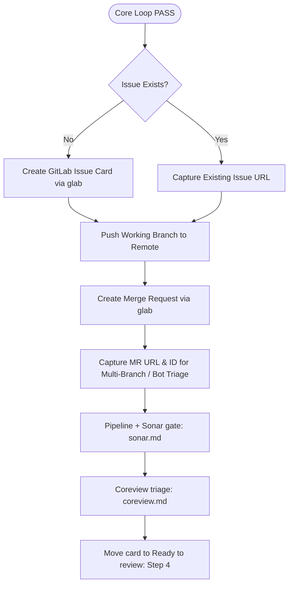

# DOT Adapter: GitLab Integration (`glab`)

## 1. Purpose & Scope

This module encapsulates GitLab operations for the DOT adapter. Once a change has passed the [generic AI Engineering Loop](../../README.md), this adapter automates issue tracking and Merge Request (MR) generation via the `glab` CLI.

---

## 2. Step-by-Step GitLab Workflow



---

## 3. Step 1: Git Context & Remote Repository Inspection

1. Check current branch and git status:
   ```bash
   git status
   git log -n 5 --stat
   ```
2. Determine repository path and remote URLs:
   ```bash
   git remote -v
   ```
3. Push working branch to remote:
   ```bash
   git push -u origin <branch-name>
   ```

---

## 4. Step 2: GitLab Issue Card Generation

### A. Check for Existing Issue
- Look for an existing issue number in:
  - Branch name (e.g. `issue-235-...`, `fix/300-...`).
  - Commit message (e.g. `fix(#300): ...`, `Refs #300`).
  - Search open issues:
    ```bash
    glab issue list --repo <repo> --search "<keywords>"
    ```

### B. Create Standardized Issue Card
If no issue exists, create one in the current repository (or the tracker named in `.ai-engineering-loop/adapter.md`):

```bash
glab issue create \
  --repo <target-issue-repo> \
  --title "[<Module>] <Summary>" \
  --description "<Issue Description Markdown>" \
  --assignee <username> \
  --label "Ready to Test" \
  --yes
```

#### Standardized Issue Description Template:
```markdown
## Issue Description
[Detailed description of the bug or feature, explaining root cause and business impact.]

## Scope
- [x] [Component 1 modified]
- [x] [Component 2 modified]
- [x] [Unit tests added in path/to/test.ts]

## Steps to Reproduce & Testing (QA)
### Pre-conditions
- <environment / data / permissions>
### Steps to Reproduce
1. <action>
2. <action that triggers the bug or the new path>
### How to Test
1. <same path after the fix, or the feature path>
2. <what QA should click / call / assert>
### Actual Result (before the fix / sebelum fix)
- <error / status / log — N/A on a pure feature>
### Expected Result (after the fix / setelah fix)
- <normal behaviour / status>
- <no error popup, no crash, no new error logs>

## Expectation
| Kondisi / Skenario | Logika Lama (Sebelum) | Logika Baru (Sesudah) |
|---|---|---|
| [Scenario 1] | [Incorrect status/error] | [Correct expected status] |
| [Scenario 2] | [Unhandled edge case] | [Properly handled] |

## Notes
- Base branch: `<target-base>`
- Verified with automated test suites.
```

---

## 5. Step 3: Base Merge Request Creation

Create the primary Merge Request targeting the base branch (`main`, `staging`, or `develop`):

```bash
glab mr create \
  --repo <current-repo> \
  --source-branch <branch-name> \
  --target-branch <target-branch> \
  --title "<type>(<scope>): <short description>" \
  --description "<MR Description Markdown>" \
  --assignee <username> \
  --yes
```

#### Standardized MR Description Template:

The **Receipt** section is `RUN_DIR/receipt.md` written by `deliver` (commit first so it binds `HEAD`; screenshots as hosted links via `--evidence AC-N=<https-url>`). Paste it unchanged; a ❌ line stays ❌. Check: `npx ai-engineering-loop verify-receipt --run <runId> --head <mr-head-sha>`.

```markdown
## Issue
<GitLab Issue URL>

## What did you do?
- <Concise point 1 explaining root cause fix>
- <Concise point 2 explaining edge cases handled>
- <Concise point 3 mentioning unit test coverage>

## Steps to Reproduce & Testing (QA)
### Pre-conditions
- <environment / data / permissions>
### Steps to Reproduce
1. <action>
2. <action that triggers the bug or the new path>
### How to Test
1. <same path after the fix, or the feature path>
2. <what QA should click / call / assert>
### Actual Result (before the fix / sebelum fix)
- <error / status / log — N/A on a pure feature>
### Expected Result (after the fix / setelah fix)
- <normal behaviour / status>
- <no error popup, no crash, no new error logs>

## Screenshot / Video
<!-- Attach screenshots, terminal test logs, or UI captures if available -->

## Receipt
<paste RUN_DIR/receipt.md from `deliver` here: one ✅/❌ line per AC with its evidence>

## Note for Deployment
- No manual database migrations required. (or specify migration command if applicable)
```

---

## 6. Step 4: Move the Card to "Ready to review"

Run this only when all three hold:

1. The MR pipeline passed and the Sonar gate is PASS or SKIPPED ([`sonar.md`](sonar.md)).
2. The Coreview triage report is printed ([`coreview.md`](coreview.md)).
3. An issue is linked to this MR (Step 2).

If the Sonar gate is FAIL, stop here. Do not move the card, and do not notify.

### A. No card linked: skip cleanly

If Step 2 found no issue and none was created (for example, the tracker is not this repo and the user did not name one), print `Card: none linked (skipped)` and continue to Mattermost. Do not create an issue just to move it.

### B. Read the board lists and the card's current labels

GitLab board columns are labels. Find the label of the "Ready to review" list and of every other list:

```bash
glab api "projects/:fullpath/boards"                # lists[].label.name per board
glab api "projects/:fullpath/issues/<issue-iid>"    # labels[] on the card
```

The target label is the list label whose name equals `Ready to review` (case-insensitive). If `.ai-engineering-loop/adapter.md` names `board_ready_label`, use that instead. No such list on any board: print `Card: no "Ready to review" list (skipped)` and continue.

### C. Move it (idempotent)

- The card already has the target label and no other list label: print `Card: already in Ready to review` and do nothing.
- Otherwise add the target label and remove only the **other board-list labels** currently on the card. Leave every non-list label alone.

```bash
glab issue update <issue-iid> --repo <repo> \
  --label "Ready to review" \
  --unlabel "<other list label currently on the card>"
```

Re-read the issue and print:

```text
Card: #<issue-iid> -> Ready to review (removed: <labels or none>)
```

Running Step 4 twice must not change anything the second time.
