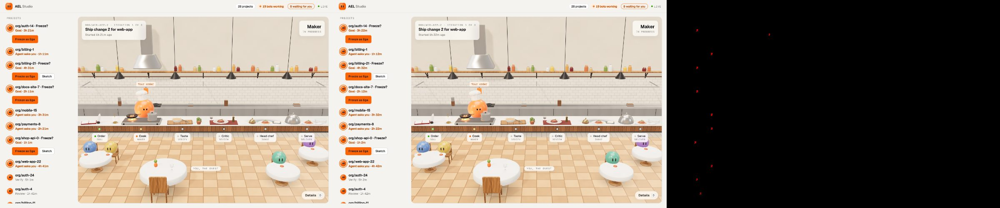
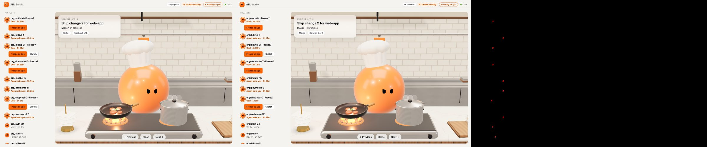
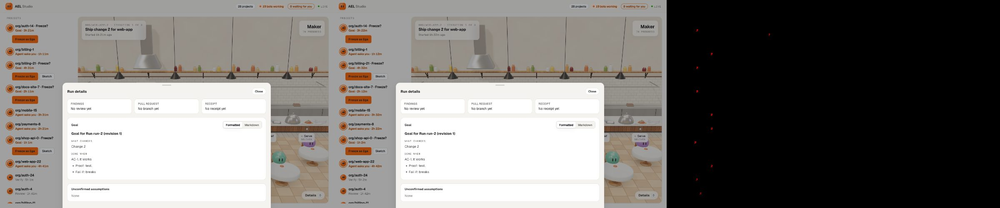
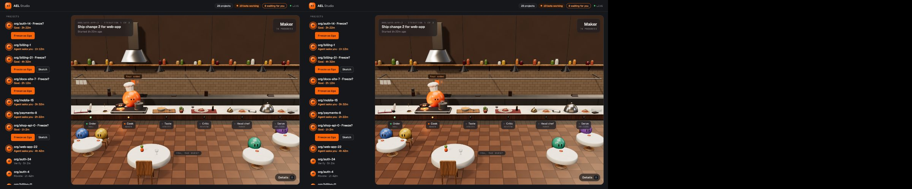
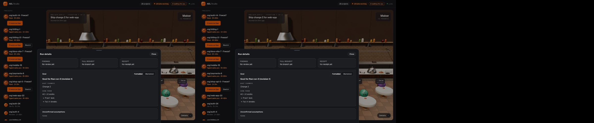
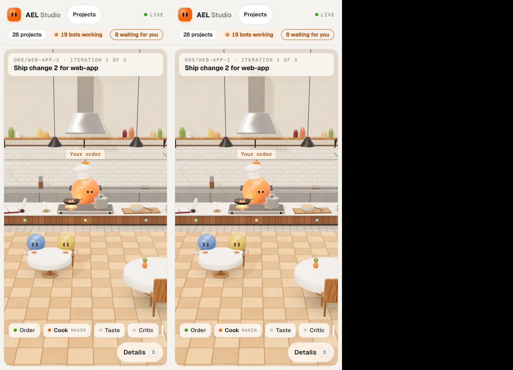
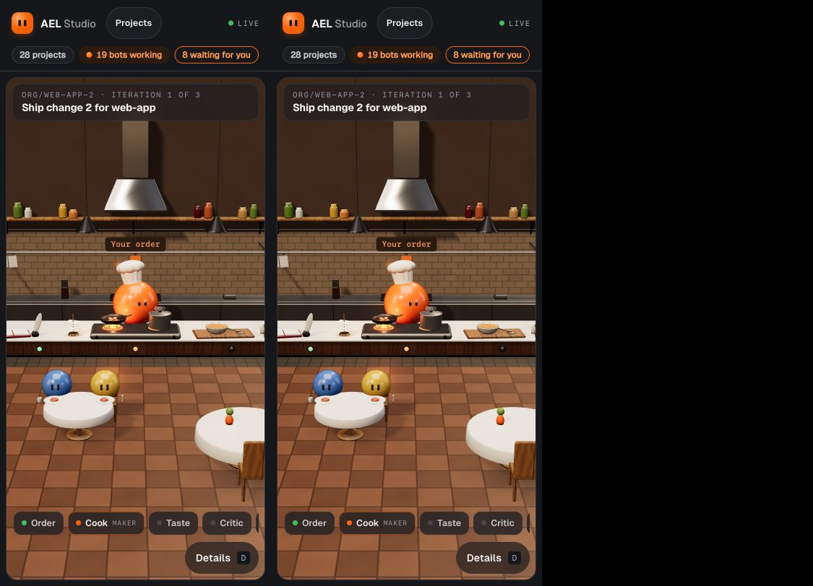

# AEL Studio performance pass (2026-11-24)

Goal: make Studio lighter and faster with the same scene, look and interactions as v3.0.0.

## Setup

- Fixture: 28 registered projects under a temp `AEL_HOME` (7 waiting for Freeze, 2 with an agent question, the rest in Maker → Deliver, one Delivered; each repo has 6 old runs and log files in the current run). Built with `createRun`, `saveGoalDraft`, `freezeGoal`, `appendRunQuestion`; the real `~/.ai-engineering-loop` was not touched.
- Two Studios side by side: v3.0.0 (`git archive HEAD`) and this branch, each started with `AEL_HOME=<temp> node bin/ai-engineering-loop.js studio --background --no-open --port …`.
- Browser: ego-browser (Chromium) driven over CDP. A page hook counted WebGL draw calls, triangles, program links, texture and buffer uploads, and rAF work; `Performance.getMetrics` gave CPU and heap. Viewports 1440×900 and 375×812, light and dark.
- Startup numbers are medians of interleaved cold loads (cache disabled), taking turns between the two servers, so both see the same machine load. The machine was busy during the session (load average 4–40, Spotlight indexing), so single wall-clock numbers moved a lot. The interleaved medians, byte counts, call counts and CPU-time numbers are the ones to trust.

## Results

### Payload (one page load, 20 requests both)

| | v3.0.0 | now |
|---|---:|---:|
| Bytes over the wire, first load | 989,729 | 237,732 (brotli) |
| Bytes over the wire, reload | 989,729 (`no-store`) | 6,907 (`304` + ETag) |
| three.js (core + module) | 750,938 | 169,608 (brotli q9) |

three.js modules used by the kitchen: 47 named exports (WebGLRenderer, Scene, PerspectiveCamera, the Mesh{Basic,Standard,Physical}Material trio, Lathe/Extrude/Sphere/Cylinder/Capsule/Torus/Cone/Box/Plane geometries, InstancedMesh, Directional/Spot/Point/Hemisphere lights, PMREMGenerator, AnimationMixer with keyframe tracks, Raycaster, DataTexture and maths). three still loads only when the 3D view is shown, so the flat fallback never downloads it.

### Startup (desktop 1440×900, cold, median of 11 interleaved loads at load average ~5)

| | v3.0.0 | now |
|---|---:|---:|
| First kitchen frame (first WebGL draw, from navigation) | 1924 ms | 1663 ms (−14%) |
| `/api/projects` response in the page | 93–124 ms | 26–32 ms |
| Main-thread texture build (11 procedural textures, same pixels) | 273–288 ms | 234–250 ms |

A repeat run at load average ~20 gave medians of several seconds for both servers and is not used. What moved the first frame: three.js starts loading at boot in parallel with `/api/me`, `/api/projects` and the Run detail, instead of after the detail arrives; there is no throwaway WebGL probe context at boot (8–370 ms of main thread, measured); the texture loops no longer allocate an array per pixel; `renderer.debug.checkShaderErrors = false` skips the info-log reads three makes for each program. Shader link time (28 programs) and the texture maths are what is left of the startup budget.

### Runtime (unchanged, by design)

| | v3.0.0 | now |
|---|---:|---:|
| Draw calls / frame (incl. shadow pass), desktop | 267 | 267 |
| Triangles / frame | 229,292 | 229,292 |
| WebGL programs | 28 | 28 |
| Geometries / textures / materials (`renderer.info`) | 175 / 16 / 112 | same |
| Texture upload estimate / vertex buffers | 45.3 MB / 7.7 MB | same |
| Animating, desktop (Cook flame) | ~36 fps, 7 ms JS/frame | same within noise |
| Animating, phone | ~60 fps, 5–6 ms JS/frame | same within noise |
| Settled Run (blinks only) | 3–5 frames/s | same |
| Hidden tab | 0 frames | 0 frames |
| JS heap | 55–115 MB (GC-dependent) | same range |

The scene already renders on demand and stops in a hidden tab. Desktop animation is bound by the GPU and compositor at 2164×1612 (the same code reaches 60 fps at the phone's canvas size). Lowering that cost would mean fewer lights, a lower pixel ratio or less blur behind the glass labels, which would change the look, so none of it was done.

### Server (28 projects)

| | v3.0.0 | now |
|---|---:|---:|
| One poll (`discoverProjects` + `summarizeProject` ×28), quiet machine, median | 68 ms | 12 ms |
| `realpath` / `lstat` calls per poll | 3266 / 1083 | 398 / 127 |
| Server CPU time over 10 min, one SSE client | 50.3 s (8.4% of a core) | 12.2 s (2.0%) |
| Server RSS over 10 min | 13–42 MB, no growth | 13–27 MB, no growth |
| SSE | 15.3 KB snapshot on connect, pushes only on change, 8-byte ping every 15 s | same |

87% of a poll was `guardTree` walking each Run tree twice and calling `contextPath` (3 `realpath` + `lstat`) on every file. Now each Run tree is walked once: the run directory is checked with `contextPath`, plain files and directories found by `readdir` inside it are inside by construction, and every symlink still goes through `contextPath`. Escaping symlinks anywhere in the tree are still refused (new test with a nested link).

## Visual parity

Screenshots of both servers with reduced motion (so frames are deterministic), same project, same viewport. Each image is v3.0.0 | now | difference ×4 in red.

| View | Changed pixels | Where |
|---|---:|---|
| Desktop light | 0.050% | elapsed-time text in the list ("3h 21m" → "3h 22m") |
| Desktop light, zoomed station | 0.046% | same |
| Desktop light, Details sheet | 0.071% | same |
| Desktop dark | 0.008% | same |
| Desktop dark, zoomed station | 0% | |
| Desktop dark, Details sheet | 0.011% | same |
| Phone light | 0% | |
| Phone dark | 0.11% (max delta under 24/255) | anti-aliasing at text edges |

The kitchen itself is pixel-identical. The procedural textures hash to the same bytes as v3.0.0 (`2f5eefe67e9de610` over all 13), and a test pins the marble pixels.

## Tried or weighed and not kept

| Idea | Outcome |
|---|---|
| Build textures in 3 module workers | Measured slower: first frame 1996 ms against 1663 ms without workers (n=11). Each worker fetches its module and warms its own JIT, which costs more than the parallelism saves. Removed. |
| Pause rendering when the kitchen is off screen (IntersectionObserver) | The layout never scrolls the kitchen out of view at any size tested (375×480 to 1440×900), so it would never fire. Removed. |
| Tree-shake three.js into a trimmed vendored file | Needs a bundler (no build step, no dev dependency today). three is 170 KB brotli, loads lazily and its parse did not show up in the startup profile; the gain is small next to shader linking. Not done. |
| `immutable` cache for static files | URLs carry no content hash, so an upgrade could serve stale files. `no-cache` + ETag gives the same reload cost (≈7 KB) safely. |
| Merge more geometry or instance the bot, diners and props | Most remaining draw calls are animated parts (bot 37 meshes, diners 24, Cook props) whose animations need separate objects. Risk to the animations for a small JS gain; not done. |
| Update the shadow map only when something moved | The bot animates on every frame while working or waiting, so the map changes anyway; only settled blink frames (3–5/s) would skip it. Not worth the tracking code. |
| Adaptive pixel ratio, cheaper shadows, fewer lights, less backdrop blur | Each changes how the scene looks. Not done. |
| `compileAsync` before the first frame | Would need the 3D view to switch on after compilation without a blank frame; not done in this pass. |
| Serve `/api/projects` from the poll snapshot | After the poll fix a fresh summary costs about 12 ms and the page calls it once per load; a cached snapshot would add a staleness rule for little gain. |
| Skip DOM writes when SSE HTML is unchanged | SSE already pushes only on change (no pushes in 10 idle minutes); skipping writes by cached string risks keeping a stale in-place state after a Freeze. |
| Cache git `user.name`, cap SSE connections | One `git config` call per page load; Studio is loopback-only behind the session cookie. Not needed. |

## Reproduce

Fixture, measurement and parity scripts were run from a scratch folder and are not part of the package. The steps: build the fixture under a temp `AEL_HOME`, start v3.0.0 and this branch on two ports, install the WebGL counting hook with `Page.addScriptToEvaluateOnNewDocument`, load each server in turn with the cache disabled, and read `performance` entries plus `Performance.getMetrics`.
